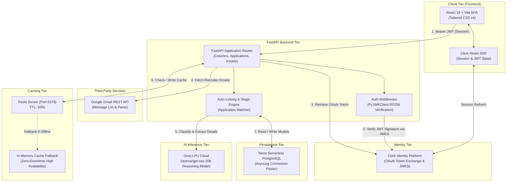

<h1 align="center">
    JobPilot AI
</h1> 

JobPilot AI is a modern, full-screen job application tracking workspace that connects directly to your inbox. It parses incoming recruiter emails with high-speed Groq AI reasoning, automatically advances cards across your Kanban pipeline (*Applied*, *Screening*, *Interview*, *Offer*, *Rejected*), and provides one-click deep links directly into Gmail.

---

## 🏛️ Deep-Dive Architecture

The following diagram illustrates the complete architectural dataflow and service boundaries across JobPilot:



---

## 🔍 Detailed Component Deep-Dive

### 1. Client & Presentation Layer
- **Framework**: React 19 bootstrapped with Vite for instant Hot Module Replacement (HMR).
- **Styling**: Tailwind CSS v4 utilizing CSS variables and an ergonomic design system. Designed specifically with a calm, focused, light palette (Slate-50 background, subtle borders, amber accents) avoiding distracting dark AI cyber-aesthetics.
- **Full-Screen Workspace**: The Kanban board takes 100% viewport height and width (`h-screen`, `w-screen`). Individual stage columns stretch vertically with independent card scrolling, while stages flow horizontally.
- **Resilient Host Resolution**: Includes automatic loopback resolution that seamlessly handles IPv4 (`127.0.0.1`) and IPv6 (`::1`) loopback differences on Windows to prevent `net::ERR_FAILED` socket rejections.

### 2. Zero-Trust Identity & Multi-Tenancy
- **Provider**: Clerk Auth Platform.
- **Token Verification**: Uses `PyJWKClient` to dynamically fetch and cache public signing keys (`.well-known/jwks.json`) from Clerk.
- **Stateless Verification**: Every incoming HTTP request must include an `Authorization: Bearer <token>` header. The token is cryptographically verified against the RS256 algorithm and issuer URL on every call.
- **Data Scoping**: Every database entity (`board_columns`, `applications`, `emails`) enforces strict row-level multitenancy via `clerk_user_id`. No user can access or mutate another user's job search records.

### 3. Inbox Ingestion & Google OAuth Token Relay
- **Token Delegation**: Instead of storing sensitive Google OAuth refresh tokens in the local database, JobPilot utilizes Clerk's OAuth token store (`https://api.clerk.com/v1/users/{id}/oauth_access_tokens/google`). Tokens are requested just-in-time and never persisted in plain text.
- **Smart Query Scoping**: Queries the Gmail REST API with a strict filter:
  ```text
  subject:(interview OR application OR offer OR position OR "thank you for applying") newer_than:60d
  ```
  Personal communications, bank receipts, and unrelated emails are never scanned or retrieved.

### 4. Groq AI Inference & Reasoning Pipeline
- **Inference Engine**: Powered by Groq's Language Processing Units (LPUs) running `openai/gpt-oss-20b`.
- **Reasoning Budget**: Configured with `max_completion_tokens=200` to allow the model's internal chain-of-thought to formulate accurate deductions before yielding final labels.
- **Entity Extraction**:
  - **Company**: Extracted from subject, body, or sender domain.
  - **Role**: Extracted job title (e.g., *Frontend Engineer*, *Data Analyst Intern*).
  - **Stage Classification**: Strictly categorizes into `Applied`, `Screening`, `Interview`, `Offer`, `Rejected`, or `Promotional`.
- **Promotional Noise Gate**: Newsletters and learning spam (e.g., Naukri MINIs, LeetCode alerts, Udemy discounts) are labeled `Promotional` and prevented from polluting the user's active Kanban board.

### 5. Automatic Card Matching & Stage Progression
- When a recruiter email arrives:
  1. If an application for that company already exists in the user's board, the card is **automatically moved** to the updated stage column matching the recruiter's latest response.
  2. If the application is new, a fresh card is automatically generated and positioned in the matching stage column.
  3. Every card embeds the recruiter's subject, sender, body snippet, and the verified `gmail_message_id`.

### 6. One-Click Gmail Deep-Linking
- Every Kanban card and email box features a verified **`Gmail ↗`** button.
- Clicking the button directly opens the exact recruiter thread in Gmail:
  ```text
  https://mail.google.com/mail/u/0/#all/{gmail_message_id}
  ```
  Users can read full thread histories and reply immediately without searching their inbox.

### 7. Dual-Tier Caching Architecture
- **Primary Cache**: Redis asynchronous client (`redis.asyncio`) with a 5-minute (300s) TTL keyed by `user:{clerk_user_id}:latest_emails`.
- **Graceful In-Memory Fallback**: If a local Redis server is not running or encounters connection timeouts (0.3s timeout threshold), the backend automatically falls back to an in-memory dictionary cache (`_memory_cache`). Caching remains 100% operational with zero service degradation or crashes.

---

## 🛠️ Complete Tech Stack

| Category | Technology | Rationale |
|---|---|---|
| **Frontend Framework** | **React 19** | Latest concurrent rendering features, state management, and declarative component tree. |
| **Build Tool** | **Vite 8** | Sub-second cold starts, lightning-fast HMR, and optimized production rollups. |
| **Styling** | **Tailwind CSS v4** | Clean, CSS-first design system without bulky runtime overhead; professional light palette. |
| **Authentication** | **Clerk** | Secure identity, session management, social OAuth token vault, and drop-in UI components. |
| **Backend API** | **FastAPI (Python 3.11+)** | High-performance async Python framework with automatic OpenAPI docs and dependency injection. |
| **ASGI Server** | **Uvicorn** | Lightning-fast async server with hot-reload capabilities and dual IPv4/IPv6 socket binding. |
| **ORM & Driver** | **SQLAlchemy 2.0 + Asyncpg** | Asynchronous relational mapping paired with the fastest PostgreSQL driver for Python. |
| **Database** | **Neon PostgreSQL** | Cloud-native serverless PostgreSQL with connection pooling to handle concurrent bursts. |
| **AI Inference** | **Groq LPU Cloud** | Near-instant token generation for zero-latency email classification (`openai/gpt-oss-20b`). |
| **Email Ingestion** | **Google Gmail REST API** | Official Google workspace integration for fetching and querying recruiter communications. |
| **Caching Tier** | **Redis + In-Memory Fallback** | Sub-millisecond response caching with automatic memory fallback for offline resilience. |

---

## 🗄️ Database Schema Design

### `board_columns`
Represents the stages of the hiring pipeline for a specific user.
- `id` (UUID, Primary Key)
- `clerk_user_id` (String, Indexed): Scopes columns to the authenticated user.
- `name` (String): Column name (e.g., *Applied*, *Screening*, *Interview*, *Offer*, *Rejected*).
- `position` (Float): Fractional ordering position (e.g., `0.0`, `1024.0`, `2048.0`).
- `color` (String): Stage badge indicator color hex.
- `created_at` / `updated_at` (Timestamps with timezone).

### `applications`
Represents tracked job applications displayed on the Kanban board.
- `id` (UUID, Primary Key)
- `clerk_user_id` (String, Indexed): Owner of the application.
- `column_id` (UUID, Foreign Key $\rightarrow$ `board_columns.id`).
- `company` (String): Company name (e.g., *Indeed*, *Stripe*, *Oasis Infobyte*).
- `role` (String): Role title (e.g., *Full Stack Developer Intern*).
- `position` (Float): Vertical card ordering within the column.
- `job_url` (String, Nullable): External job listing link.
- `notes` (Text, Nullable): Custom notes or auto-imported subject.
- `source` (String): Source identifier (`"gmail"` or `"manual"`).
- `applied_date` (DateTime with timezone): Date applied or email received timestamp.

### `emails`
Represents recruiter communications fetched from Gmail or created for testing.
- `id` (UUID, Primary Key)
- `clerk_user_id` (String, Indexed): Owner of the email.
- `application_id` (UUID, Nullable, Foreign Key $\rightarrow$ `applications.id` on delete `SET NULL`).
- `gmail_message_id` (String, Unique): Google's hex message identifier.
- `sender` (String): Recruiter email and display name.
- `subject` (String): Email subject line.
- `body` (Text): Plaintext body content.
- `received_at` (DateTime with timezone): Message delivery timestamp.
- `classification` (String): AI stage categorization (`Applied`, `Screening`, `Interview`, `Offer`, `Rejected`, `Promotional`).
- `ai_reply_draft` (Text, Nullable): AI-generated reply draft awaiting user review.

---

## 🚀 Quickstart & Setup Guide

### 1. Prerequisites
- **Node.js**: v18.0.0 or higher
- **Python**: v3.11 or higher
- **Accounts**:
  - [Clerk Dashboard](https://dashboard.clerk.com) for authentication.
  - [Neon Console](https://console.neon.tech) for hosted serverless Postgres.
  - [Groq Console](https://console.groq.com) for API inference keys.
  - [Google Cloud Console](https://console.cloud.google.com) for Gmail API OAuth credentials.

---

### 2. Backend Setup

1. **Navigate to the backend directory and activate the virtual environment**:
   ```powershell
   cd backend
   .\backend\Scripts\activate
   ```

2. **Install dependencies**:
   ```powershell
   pip install -r requirements.txt
   ```

3. **Configure Environment Variables**:
   Create a `.env` file inside `backend/` using the provided `.env.example`:
   ```ini
   DATABASE_URL=postgresql+asyncpg://<user>:<password>@<neon-host>/neondb?ssl=require
   CLERK_ISSUER=https://<your-subdomain>.clerk.accounts.dev
   CLERK_PUBLISHABLE_KEY=pk_test_...
   CLERK_SECRET_KEY=sk_test_...
   ALLOWED_ORIGINS=http://localhost:5173,http://127.0.0.1:5173,http://localhost:5174,http://127.0.0.1:5174
   GROQ_API_KEY=gsk_...
   REDIS_URL=redis://localhost:6379/0
   ```

4. **Initialize Database Tables**:
   ```powershell
   python scripts/create_tables.py
   ```

5. **Start the FastAPI server**:
   ```powershell
   uvicorn app.main:app --reload --host 0.0.0.0 --port 8000
   ```
   *The `--host 0.0.0.0` flag binds to all local network interfaces, ensuring both IPv4 and IPv6 requests resolve cleanly.*

---

### 3. Frontend Setup

1. **Navigate to the frontend directory**:
   ```powershell
   cd superfolio
   ```

2. **Install dependencies**:
   ```powershell
   npm install
   ```

3. **Configure Environment Variables**:
   Create a `.env` file inside `superfolio/`:
   ```ini
   VITE_CLERK_PUBLISHABLE_KEY=pk_test_...
   ```

4. **Run the Vite development server**:
   ```powershell
   npm run dev
   ```
   Open [http://localhost:5173](http://localhost:5173) in your browser.

---

### 4. Google Cloud OAuth Configuration

To enable real Gmail inbox synchronization:
1. Open the [Google Cloud Console](https://console.cloud.google.com/).
2. Select your JobPilot project and navigate to **Google Auth Platform** $\rightarrow$ **Audience** (or **OAuth consent screen**).
3. Under **Test users**, click **+ ADD USERS**.
4. Enter the Gmail address of your test account and click **Save**.
5. Connect your Google account inside Clerk to grant `https://www.googleapis.com/auth/gmail.readonly` access.

---

## 📡 API Reference

| Method | Endpoint | Description |
|---|---|---|
| `GET` | `/columns` | Fetch all Kanban columns for the authenticated user (auto-creates defaults if none exist). |
| `GET` | `/application` | List all applications enriched with embedded recruiter email details and Gmail links. |
| `POST` | `/application` | Create a new manual application card. |
| `PATCH` | `/application/{id}` | Update application fields or move the card to another stage column. |
| `DELETE` | `/application/{id}` | Permanently delete an application card. |
| `GET` | `/emails` | List all recruiter emails for the user (reads from cache or Neon DB). |
| `POST` | `/emails/sync` | Ingest new messages from Gmail, run Groq AI classification, and auto-link cards. |
| `POST` | `/emails/seed` | Seed realistic mock recruiter emails to test board functionality without OAuth setup. |
| `POST` | `/emails/{id}/classify` | Trigger an on-demand Groq AI re-classification of a specific stored email. |

---

## 👨‍💻 Creator

Developed by **Saksham Bansal** ([@SakshamBansal753](https://github.com/SakshamBansal753))
- 📍 Gwalior, India
- 🐙 46+ Open-Source Repositories
- 💡 Featured Projects: [gitai](https://github.com/SakshamBansal753/gitai) (FastMCP + Groq natural language Git CLI), [switch](https://github.com/SakshamBansal753/switch) (MCP AI teammates), [JobPilot AI](https://github.com/SakshamBansal753).
- 🧩 1000+ Algorithmic Problems Solved

---

## Roadmap

- [x] Auth (Clerk sign-in/sign-up)
- [x] `board_columns` — customizable Kanban columns, seeded with defaults on first visit
- [x] `applications` — the actual cards
- [ ] Drag-and-drop (cards between/within columns, columns reordering)
- [ ] Gmail integration — auto-create/move cards from recruiter emails
- [ ] AI resume matching
- [ ] AI cover letter generation
- [ ] Interview prep tools
- [ ] Application analytics
